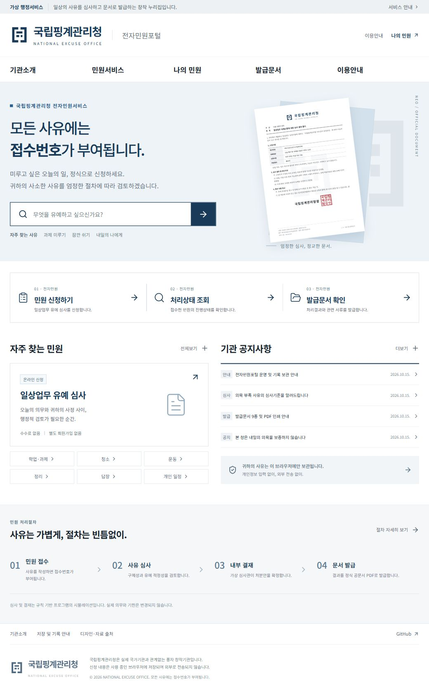

# 국립핑계관리청 전자민원포털

**모든 사유에는 접수번호가 부여됩니다.**

사소한 생활상의 일을 미루고 싶은 사유를 접수하고, 가상의 엄정한 심사·결재 절차를 거쳐 한국형 공문서 PDF를 발급하는 무료 풍자 웹서비스입니다.

- 서비스: https://aru-tris.github.io/national-excuse-office/
- 원본 제품 명세: [국립핑계관리청.md](./국립핑계관리청.md)
- 브랜드·서식 자료: 서비스의 `#/design`



## 가상기관 안내

국립핑계관리청, 조직, 담당 직위, 운영규정 및 관인은 창작된 설정입니다. 실제 국가기관과 관계가 없으며 실제 업무·학업 의무나 기한을 변경하지 않습니다. 질병·출석·고용·법률상 허가 등 외부 사실을 증명하는 문서를 발급하지 않습니다. 모든 PDF에 `가상기관 창작문서` 표시가 들어갑니다.

## 구현된 기능

- 민원 안내 → 작성 → 전체 내용 확인·필수 동의 → 접수 → 심사 → 결과 → PDF 발급
- 엄격/관대한 규칙 기반 심사, 규칙 버전과 결정 스냅샷 보존
- 문장 규칙 v2.0: 진행 상태·사유·부정 표현·기한·복귀 계획 추출, 근거를 인용한 개별 심사 의견
- 보완자료 1회 제출과 최종 처분, 불승인 사건의 이의신청 1회
- F-01~F-09 전체 서식, 사건에서 실제 발생한 문서만 발급
- 검색 가능한 한글·Hanja·영문 벡터 PDF, 글꼴 내장, A4 다중 페이지, 사각 관인, 기관 심벌 워터마크
- 실제 다운로드 Blob을 PDF.js로 미리보기, 확대·페이지 이동·인쇄용 PDF 열기
- 사건별 문서 ZIP, IndexedDB 기록·임시저장, JSON 백업/복원, 개별·전체 삭제
- 모바일 대응, 키보드 조작, 단계·오류 안내, 움직임 감소 설정
- GitHub Pages 하위 경로 및 HashRouter 직접 링크 지원

신청 내용은 외부 API로 보내지 않습니다. 분석/추적 스크립트, 유료 AI, 로그인, 이메일 및 결제 기능을 사용하지 않습니다. 글꼴과 정적 자원은 같은 사이트에서 불러옵니다. 저장소가 막히면 현재 탭의 임시 보관임을 분명히 표시하고 백업 경로를 제공합니다.

1.1.0부터 새 심사는 `review-engine/2.0`을 적용합니다. 문장 길이로 구체성을 정하지 않고, 실제로 기재한 사정과 복귀 시점·첫 행동을 함께 검토합니다. 기존 v1.0 사건·문서·JSON 백업은 유지되며 재계산하지 않습니다. 지원 범위, 결정 기준, 실제 입출력 예시는 [문장 심사 엔진](docs/review-engine.md)에 정리했습니다.

## 실행

Node.js 24 LTS와 npm을 권장합니다.

```sh
npm ci
npm run dev
```

개발 주소: `http://127.0.0.1:5173/national-excuse-office/`.

```sh
npm test
npm run test:e2e
npm run test:pdf
npm run build
npm run preview
```

로컬 Playwright는 설치된 Google Chrome을 사용합니다. CI 환경은 Chromium을 사용하므로 E2E 실행 전에 `npx playwright install --with-deps chromium`을 실행하세요. PDF 검증은 React PDF로 실제 아홉 서식과 장문 문서를 생성합니다. 추가 구조 검사는 `python scripts/check-pdfs.py`로 실행하며 `pypdf`, `pdfplumber`가 필요합니다. PNG 렌더링에는 Poppler가 필요합니다.

## 구조

```text
public/brand/             자체 제작 벡터 심벌·로고·관인
public/fonts/             로컬 PDF 글꼴과 SIL OFL
public/samples/           명확히 구분된 대표 서식 예시
src/domain/              검증, 심사 규칙, 사건 전이와 고정 문서 스냅샷
src/storage/             Dexie IndexedDB, 임시 보관, 백업 및 복원
src/documents/           아홉 서식, mm/pt 토큰, PDF·ZIP 발급
src/components/          포털 UI와 실제 PDF 미리보기
src/pages/               신청·조회·보완·이의신청·기관/이용 안내
tests/                   도메인·저장소 단위 테스트와 브라우저 E2E
docs/                    브랜드, 문서, 검수·배포 기록
output/pdf/              인쇄용 샘플과 PDF 검증 산출물
```

## 배포

`main`에 푸시하면 GitHub Actions가 `npm ci` → 단위 테스트 → PDF 생성 검증 → 프로덕션 빌드 → Pages 배포를 진행합니다. 저장소의 Settings → Pages → Source는 **GitHub Actions**입니다. `vite.config.ts`의 `base`는 `/national-excuse-office/`이며 저장소명을 바꾸면 함께 수정해야 합니다.

## 기록과 날짜

접수번호는 브라우저 내 중복을 검사한 무작위 번호이며 전국 공통 발급대장을 주장하지 않습니다. 행정 일자는 `Asia/Seoul`로 계산합니다. 최초 문서번호·발급일·결정은 재열람 시 유지됩니다. 이의신청 결과는 원처분 문서를 덮어쓰지 않습니다. JSON 가져오기는 형식·스키마·기록 일관성을 먼저 검증하며, 이미 있는 사건 ID나 접수번호는 보존합니다.

## 디자인 및 자료 출처

포털 정보구조는 [KRDS](https://www.krds.go.kr/)의 [신청서 작성 패턴](https://www.krds.go.kr/html/site/service/service_04_05.html), 서식 구성은 [행정안전부 2025 행정업무운영 편람](https://www.mois.go.kr/frt/bbs/type001/commonSelectBoardArticle.do?bbsId=BBSMSTR_000000000012&nttId=122878)과 [문서 관련 시행규칙](https://www.law.go.kr/LSW/lsInfoP.do?lsiSeq=252189)을 참고했습니다. 실제 정부 표장이나 실존 관인을 복제하지 않았습니다. 이 참고자료는 가상 문서의 법적 근거가 아닙니다.

웹은 Noto Sans KR, PDF는 정적 인스턴스로 만든 Noto Sans KR/Noto Serif KR을 사용합니다. 로고타입·관인 윤곽의 기반은 Nanum Gothic Bold이며, 모든 폰트는 SIL Open Font License로 제공됩니다. 라이선스는 `public/fonts`와 Noto Sans KR 배포 패키지에 포함되어 있습니다. 구현은 [Vite](https://vite.dev/guide/static-deploy.html), [React PDF](https://react-pdf.org/docs/v4/fonts), [PDF.js](https://mozilla.github.io/pdf.js/), Dexie, JSZip을 사용합니다.

## 검증 범위

자동화 결과와 제한사항은 [검수 기록](docs/acceptance-checklist.md)에 정리합니다. A4 파일 구조, 한글·한자 추출과 렌더링을 검증하지만 **실제 컬러/흑백 프린터 출력은 수행하지 않았습니다.** 사용자는 대표 샘플 F-05/F-06/F-07을 A4 100%로 출력해 실제 인쇄 품질을 최종 확인할 수 있습니다.
